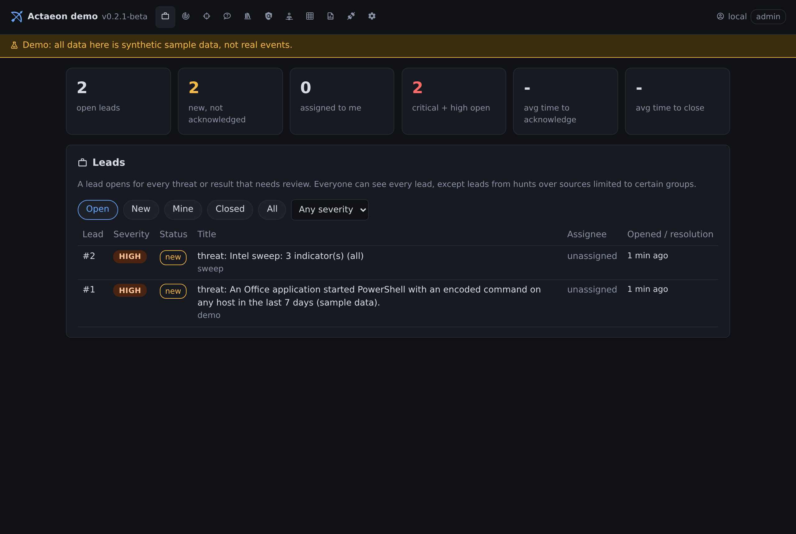
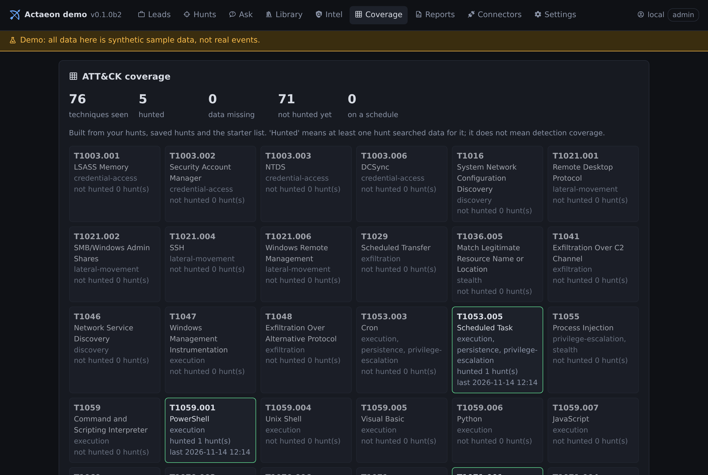
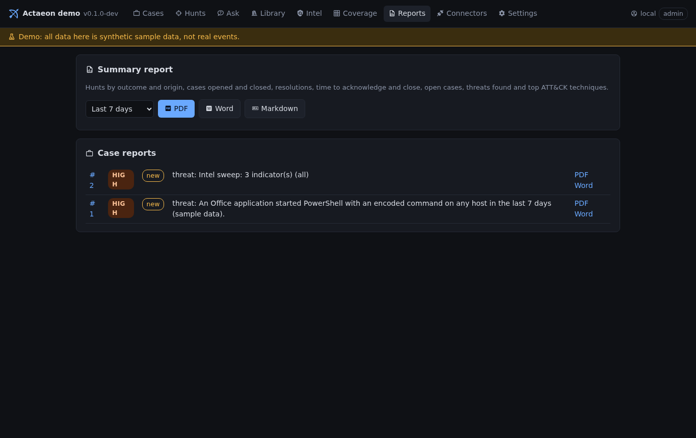

# Actaeon

**An open-source AI threat hunter.** You give it a hypothesis ("an Office app started encoded
PowerShell this week"). Actaeon plans the hunt, queries your own data sources, follows pivots, and
writes a verdict that cites its evidence and maps to MITRE ATT&CK. When it cannot be sure, it hands
the hunt to a person instead of guessing.

- **Read-only.** It looks; it never isolates, deletes or changes anything.
- **Works with what you already run.** Every data source is reached through the Model Context
  Protocol (MCP), so it is not tied to any product.
- **Any model.** Use a cloud model or one on your own hardware. Each hunt step can use a different one.
- **Fully open source.** Apache-2.0. Every feature is in this repository. There is no paid
  edition, no licence key and no telemetry.

> **Status: beta (0.1.0b1).** It has been tested in one home lab and on public and synthetic
> benchmarks, but not yet in production. It runs as one process on one machine. Read
> [known limitations](docs/known-limitations.md) before relying on it.


## Try it in a minute

```bash
pip install -e .
actaeon demo --offline --run                  # synthetic data, scripted run (no AI, no keys)
ACTAEON_HOME=~/.actaeon-demo actaeon serve    # open http://127.0.0.1:8611
```

The demo has a planted attack and a harmless look-alike, and all of its data is labelled SAMPLE.
See [docs/demo.md](docs/demo.md).

| Leads | Hunt verdict and evidence |
|---|---|
|  |  |
| **ATT&CK coverage** | **Reports** |
|  |  |

## How a hunt works

1. **Plan.** The planner model turns the hypothesis into steps, and asks for data by *role*
   (log search, endpoint, identity, email, asset, network, cloud, intel). It never asks for a product.
2. **Query.** The analyst model calls connector tools. Before each call, a validator enforces a time
   range, a result cap and known field names, and refuses any write. Pacing and time limits apply too.
3. **Pivot.** It follows what it finds to the same host, user or destination, in other sources and
   in intel.
4. **Verdict.** The outcome is one of `threat`, `no_results`, `telemetry_found_benign`, `logs_missing`
   or `inconclusive`. Every claim must cite a successful result that contains the values it names.
   Missing data is reported as missing, never as clean.
5. **Second look.** Before a threat is reported, a separate pass tries to prove it wrong.
6. **Hand-off.** When it cannot answer, a "needs analyst" lead opens. The lead says what was
   searched, what was missing and what to check next.

## What is included

| Area | What you get |
|---|---|
| Hunting | Hypothesis hunts, saved hunts with scheduled replays, a starter library of hypotheses, advisory-driven hunts, threat-actor and campaign hunts, an intel sweep over the indicator ledger |
| Sources | Any MCP server, plus built-in bridges for search indices, read-only SQL, STIX/TAXII 2.1 and any REST/OpenAPI service. Each connector gets query notes and examples in its own query language |
| Intel | A local indicator and advisory store with first/last-seen tracking. Paste IOCs, import files, PDFs or URLs, or pull feeds |
| Analyst work | Leads with assignment, status, resolution and history; chat on a finished hunt; feedback on findings; a timeline view |
| Detection | Draft rules from a hunt (Sigma, plus native queries) with a backtest of how often they would have fired |
| Outputs | Email, Excel, webhook, or a write tool you explicitly allow (such as opening a case). A reply in the ticket can continue the hunt |
| Reports | Markdown, CSV, PDF and Word, plus an ATT&CK coverage view |
| Access | `basic`, `local`, OIDC single sign-on or a trusted proxy, with viewer, operator and admin roles. All of these are free |
| Interfaces | Web UI, CLI, REST API, and Actaeon itself as an MCP server |
| Running it | pip, Docker / compose (non-root, read-only filesystem) or systemd. Runs fully offline with local models |

## Safety model

Actaeon reads attacker-controlled text (command lines, user agents, emails), so the controls are
in code, not only in prompts:

- **Read-only by default.** Write-like tools are blocked. Response and destructive actions are
  always blocked, whatever the configuration says.
- **Query guard.** Every query needs a time window. Results, runtime per query, steps and tokens
  per hunt are all capped. Each connector is rate-limited. Costly leading wildcards are refused on
  log indices.
- **Untrusted data.** Every tool result is wrapped in random markers and treated as data. Text in
  the logs that tries to instruct an AI becomes a high-severity lead of its own.
- **Evidence checks.** A claim that cites nothing real is dropped, and the verdict is downgraded.
- **Memory only from people.** Models and data sources cannot write memory. "Benign" notes expire
  (90 days by default), so one wrong call cannot hide activity for good.
- **Audit.** Every tool call, including blocked ones, goes to an append-only, hash-chained log.
  `actaeon audit verify` checks it.
- **Privacy.** Personal data can be masked before a prompt reaches a cloud model.

Details: [docs/threat-model.md](docs/threat-model.md), [docs/connectors.md](docs/connectors.md),
[docs/privacy.md](docs/privacy.md).

## Results so far

| Test | Result |
|---|---|
| Lab benchmark on a frozen week of real SIEM data (11 labelled cases) | 11 / 11; 5 of 5 threats found, no false positives |
| ExCyTIn-Bench sample (80 public investigation questions) | mean reward 0.512, 40 / 80 fully correct |
| Field test: implant planted where no detection rule covered it | found from host inventory with no alert behind it |

These came from one model on small samples, and the cases were written by someone who knew the
answers. Read them as "it checks and clears correctly", not as proof that it finds every attacker.
Run the same tests yourself with `actaeon bench`. Details, failures included, are in
[docs/benchmarks.md](docs/benchmarks.md) and [docs/field-test-2026-11.md](docs/field-test-2026-11.md).

## Install

**Python (3.10+)**

```bash
python -m venv .venv && . .venv/bin/activate
pip install -e '.[all]'      # or just -e . ; extras add cloud SDKs, PDF/Word reports, Excel
actaeon init                 # writes config.yaml and .env
actaeon serve                # http://127.0.0.1:8601
```

**Docker**

```bash
docker compose up -d         # http://127.0.0.1:8601, data in ./actaeon-data
```

**Linux service (systemd)**

```bash
sudo bash scripts/install.sh all
```

Actaeon refuses to start on a network address without a login. See [docs/deploy.md](docs/deploy.md).

## Set it up for your environment

1. **Models.** Pick a provider for each role (`planner`, `analyst`, `reporter`): Ollama,
   Anthropic, Gemini, OpenAI, Azure OpenAI or any OpenAI-compatible server. Run
   `actaeon models test` to check them. See [docs/models.md](docs/models.md).
2. **Connectors.** Add your sources as MCP connectors with roles. Use read-only service accounts.
   Run `actaeon connectors test` to check them. See [docs/connectors.md](docs/connectors.md) and
   [docs/bridges.md](docs/bridges.md).
3. **Environment profile.** Describe what runs here, what matters most and what is normal, so hunts
   fit your estate. See [docs/company-setup.md](docs/company-setup.md).
4. **Check.** `actaeon doctor`.

Keep your organisation's setup in a private configuration folder (`actaeon init --company DIR`),
not in this repository.

## Documentation

| Topic | Doc |
|---|---|
| Hunting, limits, verdicts, chat | [docs/hunting.md](docs/hunting.md) |
| Saved hunts, schedules, sweeps, memory | [docs/library.md](docs/library.md) |
| Connectors and bridges | [docs/connectors.md](docs/connectors.md), [docs/bridges.md](docs/bridges.md) |
| Intel store and feeds | [docs/intel.md](docs/intel.md) |
| Autonomy: web intel and autopilot | [docs/autonomy.md](docs/autonomy.md) |
| Outputs and ticket replies | [docs/outputs.md](docs/outputs.md) |
| Models and providers | [docs/models.md](docs/models.md) |
| Privacy masking | [docs/privacy.md](docs/privacy.md) |
| Organisation setup | [docs/company-setup.md](docs/company-setup.md) |
| Deployment | [docs/deploy.md](docs/deploy.md) |
| Actaeon as an MCP server | [docs/mcp-server.md](docs/mcp-server.md) |
| Benchmarks | [docs/benchmarks.md](docs/benchmarks.md) |
| Threat model, limitations | [docs/threat-model.md](docs/threat-model.md), [docs/known-limitations.md](docs/known-limitations.md) |

## What it is not (yet)

- **Not a SIEM or SOAR.** It sits beside them as a read-only investigator, and takes no response
  actions.
- **Not clustered.** It is one process with SQLite storage. There are no separate workers and no
  high availability yet.
- **Measured with one model only.** Small local models were not good enough to hunt in testing.
- **Not proven in production yet.**

## Contributing

Bug reports, hunt hypotheses, connector notes and benchmark runs with other models are all
welcome. See [CONTRIBUTING.md](CONTRIBUTING.md) and [SECURITY.md](SECURITY.md) for how to report
a vulnerability.

```bash
pip install -e '.[dev]'
ruff check actaeon tests benchmarks scripts && node --check actaeon/static/app.js && pytest -q
```

## License

Apache-2.0. See [LICENSE](LICENSE), [NOTICE](NOTICE), [DISCLAIMER.md](DISCLAIMER.md) and
[CODE_OF_CONDUCT.md](CODE_OF_CONDUCT.md). All features are in this repository, under this licence.
