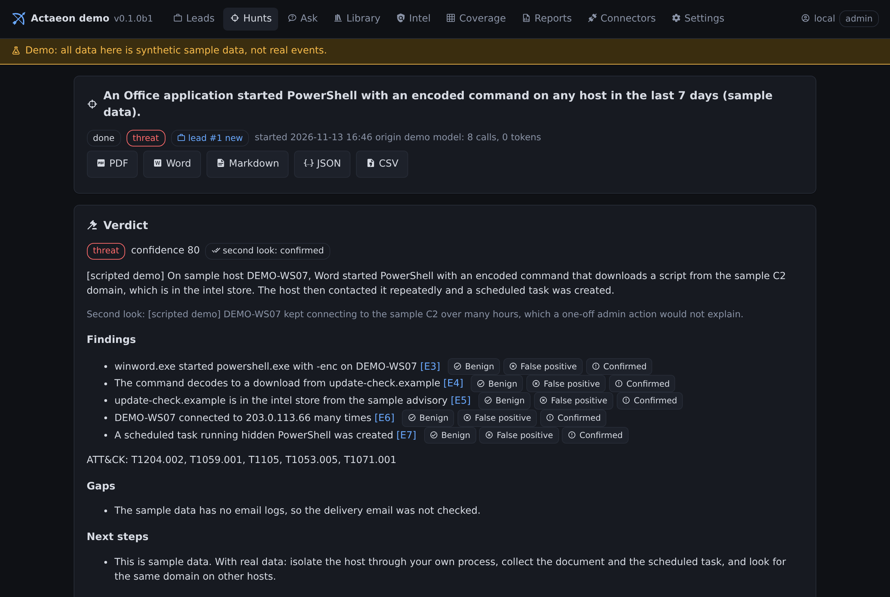

# Actaeon

Actaeon is an open-source AI threat hunter, in beta. You give it a
hypothesis and it plans a hunt, queries your data sources, follows pivots, and writes
a verdict that cites its evidence and maps to MITRE ATT&CK.

It talks to every data source through the Model Context Protocol (MCP). You add each source
as a connector and tag it with a role: log search, endpoint, identity, email, asset, network,
cloud or intel. You can also add intel yourself (paste IOCs or an advisory, import
files, pull feeds) into a built-in store that hunts read like any other intel source.
The hunt engine asks for a role, never a specific product. Tools are
read-only by default, and every tool call is written to an audit log.

> **Beta (0.1.0b1).** Read-only, single machine, tested in one home lab and on public and synthetic
> benchmarks, not yet in production. See [what changed](CHANGELOG.md), the
> [known limitations](docs/known-limitations.md), and start with [docs/connectors.md](docs/connectors.md)
> and [docs/hunting.md](docs/hunting.md).

## Try it


*Recorded from `actaeon demo --offline --run` using `scripts/make_demo_gif.py`.*

```bash
pip install -e .
actaeon demo --offline --run                  # sample data, scripted run (not AI)
ACTAEON_HOME=~/.actaeon-demo actaeon serve    # http://127.0.0.1:8611
```

| Leads | Hunt Verdict & Evidence |
|---|---|
|  |  |
| **ATT&CK Coverage** | **Reports** |
|  |  |

See [docs/demo.md](docs/demo.md). Before relying on it, read
[DISCLAIMER.md](DISCLAIMER.md), [docs/known-limitations.md](docs/known-limitations.md), and
[docs/threat-model.md](docs/threat-model.md).

## Where Actaeon fits

Actaeon is a young, MCP-first threat hunter designed for small teams and
labs that want one model-agnostic interface across whatever log, endpoint,
identity, and intel sources they already run.

- **Compared with mature SIEM/SOAR platforms:** those platforms have years of
  tuned correlation rules, native connectors, high availability, and enterprise
  RBAC. Actaeon does not replace them; it sits alongside them as a read-only
  hypothesis-driven investigator over MCP.
- **What is still missing:** single-process SQLite execution (no HA clustering), benchmark
  numbers for more than one model (so far one fast cloud model), and a test in a production
  environment.

## Results so far

| Test | Result |
|---|---|
| Lab benchmark on a frozen week of real SIEM data (11 labelled cases) | 11 / 11; 5 of 5 threats found, no false positives |
| ExCyTIn-Bench sample (80 public investigation questions) | mean reward 0.512, 40 / 80 fully correct |
| Field test: implant planted where no detection rule covered it | found from host inventory with no alert behind it |

One model, small samples, and cases written by someone who knew the answers: read these as
"it checks and clears correctly", not as proof it finds every attacker. Details, failures included,
are in [docs/benchmarks.md](docs/benchmarks.md) and [docs/field-test-2026-11.md](docs/field-test-2026-11.md).

## When it cannot answer

Actaeon does not guess. A hunt that runs out of steps, lacks the data it needs, cannot confirm a
threat on a second look, or only finds things you listed as normal is handed to a person: a
"needs analyst" lead opens with what was searched, what was missing and what to check next.
Missing data is reported as missing, never as clean. See [docs/hunting.md](docs/hunting.md).

## Run on Linux (systemd)

```bash
sudo bash scripts/install.sh all
```

See [deploy/actaeon.service](deploy/actaeon.service) and [docs/deploy.md](docs/deploy.md).

## Run with Docker

```bash
docker compose up -d      # http://127.0.0.1:8601, data in ./actaeon-data
```

See [docs/deploy.md](docs/deploy.md) for hardening and the network rules it needs.

## Quick start

```bash
python -m venv .venv && . .venv/bin/activate
pip install -e '.[dev]'
actaeon init          # writes config.yaml and .env
actaeon serve         # http://127.0.0.1:8601
```

## Models

Each step of a hunt uses a model role (`planner`, `analyst`, `reporter`). Each role can use
a different provider: local Ollama, Anthropic, Gemini, OpenAI, Azure OpenAI or any
OpenAI-compatible endpoint. Change them under **Models** in the UI or in `config.yaml`.
Keys go in `.env`. Cloud SDKs are optional extras (`pip install 'actaeon[all]'`).
Recipes for every way to connect (including Vertex AI with a service account,
workload identity or a gateway) are in [docs/models.md](docs/models.md);
`actaeon models test` checks a setup.

## Autonomy

Actaeon can pull advisories from security news feeds and advisory sites, decide which ones
matter to your environment (what you run, by name) and hunt only those, keeping every decision
in the intel ledger. It can also propose its own
hypotheses from intel, coverage gaps and earlier findings (autopilot), and look
up public indicators on the web during a hunt. It can also use model command-line
clients you are signed in to, with fallbacks when a model hits its quota. See
[docs/autonomy.md](docs/autonomy.md).

## Outputs

Results can go to email, an Excel workbook, a webhook, or a tool you allow (for
example opening a case). See [docs/outputs.md](docs/outputs.md).

## For an organisation

See [docs/company-setup.md](docs/company-setup.md): a private configuration folder
(`actaeon init --company DIR`), read-only service accounts, query notes,
`actaeon doctor`, SSO and named accounts.

## Also included

- Personal data masking before prompts reach cloud models ([docs/privacy.md](docs/privacy.md)).
- An offline decoder for obfuscated command lines (`actaeon decode`, and a tool hunts can use). It never runs them.
- An environment profile in `config.yaml` (platforms, products, key assets, what is not present, and
  what is known good) given to every hunt.
- Data sources beyond logs: host inventory (running processes, listening ports, accounts, packages) and
  read-only SQL databases, so it can find what exists right now even when no event was logged.
- Draft detection rules from a hunt, and a backtest of how often they would have fired.
- Feedback on findings (benign, false positive, confirmed). Benign calls become memory for later hunts.
- Advisory import from a URL, a PDF or HTML file, or pasted text.

## Authentication

`auth.mode` can be `none` (loopback only), `basic`, `local`, `oidc` or `proxy`, with
viewer, operator and admin roles. Actaeon will not start if it would listen on a
network address with no login.

## Development

```bash
ruff check actaeon tests benchmarks scripts && node --check actaeon/static/app.js && pytest -q
```

## License & Community

Apache-2.0. See `LICENSE`, `NOTICE`, [`DISCLAIMER.md`](DISCLAIMER.md),
[`CONTRIBUTING.md`](CONTRIBUTING.md), and [`CODE_OF_CONDUCT.md`](CODE_OF_CONDUCT.md).
