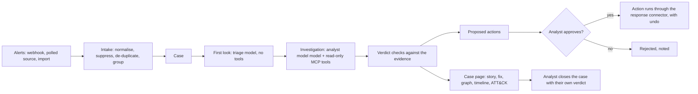

# Alert triage

Alert triage turns alerts into cases and investigates each one through the same read-only
connectors, models and checks as a hunt. It is configured under `soc:` in `config.yaml` and shown under
**Cases** in the UI.



## 1. Intake (no model)

Alerts arrive as JSON from any source. `normalize` finds the usual fields (rule, severity, time,
host, user, addresses, process, command line, domain, hash, file, ATT&CK ids) under the keys alerts
commonly use; `soc.intake.field_map` adds yours. Then:

- **Suppressions** that match the rule (and entity, if set) store the alert as suppressed. No case.
- **Duplicates** (same alert id) only bump a counter.
- **Grouping**: an alert joins an open case with the same fingerprint (same rule on the same host,
  user or address), or one that shares a host, user, external address, domain or hash and has not
  been triaged yet, within `soc.intake.group_window_min`. Shared infrastructure that touches everything
  (a sign-in server, a proxy) is excluded with `soc.intake.no_group`.

See [Intake](#intake-push-post-apialerts) below for the details.

## 2. First look (planner role)

A short prompt with the alerts, how earlier cases with the same rule ended (by the analyst's
verdict where there is one) and related cases. The model returns a priority (P1 to P4), what it
thinks is likely, and the questions the investigation must answer. It has no tools and decides
nothing.

## 3. Investigation (analyst role)

The analyst model gets the alerts, the first-look plan, the environment description, matching
[playbooks](playbooks.md), the tool list with query notes, and the response actions it may
propose. Each turn it makes one tool call or gives the verdict. Every call:

1. must name a tool that a connector with an investigation role offers and the policy allows
   (read-only, see [connectors.md](connectors.md));
2. passes the validator (schema, a time range for search tools, result caps, no write or code
   patterns in query text);
3. passes a field check (queries that name fields the index does not have are refused with close
   matches);
4. runs through the hub (pacing, retries, time limits, audit log) and comes back wrapped as
   untrusted data;
5. is stored as evidence `E<n>` and scanned for text that tries to instruct an AI.

Repeated calls are not run again. Limits: `soc.max_steps`, `max_runtime_sec`, `max_tokens`.

## 4. Verdict checks

The model's verdict is checked against the record before it is stored (see [Checks](#checks)):
citations must point at successful calls, a true positive needs cited evidence, a false positive or
benign verdict needs at least one successful data search, failed sources mean `logs_missing`, text
that tries to steer the AI sends the case to a person, and proposed actions must be configured and
target an entity of the case.

## 5. The case

The case page shows what happened in plain language, the findings with their evidence, the fix
(remediation steps or a tuning proposal), proposed actions with approve and reject buttons, the
entity graph, the timeline, the ATT&CK chain, every alert, the first look, every tool call with its
result, related cases and notes. The analyst closes it with their own verdict; both are kept and
compared on the dashboard.

## 6. Response

Proposed actions never run on their own. See [response.md](response.md).

## Fixed checks, no-model mode and escalation

Actaeon does not need a model to triage. Before any model sees a case, **fixed checks** collect evidence
the same way every time, read-only:

| Step | What it does |
|---|---|
| `decode` | decodes an obfuscated command line from the alert (never runs it) |
| `intel` | looks external addresses, domains, URLs and hashes up in the intel connectors |
| `context` | events on the same host from 30 minutes before the first alert to 30 minutes after the last |
| `inventory` | what runs, listens and which accounts exist on the host now (snapshot connectors) |
| `auth` | for sign-in alerts: how many accounts the source tried, and whether any sign-in succeeded |
| `spread` | which other hosts contacted the same destination or domain in the last week |

`decode` and `intel` always run; the matching [playbooks](playbooks.md) choose the rest (`collect:`), and all of
them run when no playbook matches. Field names are found with each connector's `get_fields` (`agent.name`,
`host.name`, `data.srcip`, ...), or named in the connector's config with `fields: {host: ..., user: ...}`. The
queries use query_string (Lucene) syntax, so the steps run on connectors with that dialect, such as the
bundled search-index bridge. Every result is stored as evidence `E<n>` and read in full by the rules.

Plain rules turn the results into **signals**, each citing its evidence: an intel match, a decoded command that
downloads and runs code, a download piped into a shell, a process running from a temporary path, a process with
a hidden name listening on a port, an account other than root with user id 0, one source trying ten or more
accounts, a successful sign-in after failures, an Office application starting a shell, an indicator seen on
several hosts, a match with a known-good note. A finding is only counted for the alert when it concerns the
alert's own process, account, command, address or domain. Anything else on the same host is shown as "the host
also shows: ..." and sends the case to a person without making the alert a true positive.

What happens next depends on `soc.analysis`:

- **`rules`: no model at all.** A strong signal with evidence makes a `true_positive` (confidence 60, more with
  several independent signals). A known-good match with no strong signal makes `benign`. Everything else goes to
  an analyst with the evidence collected. Rules never close a case on their own: they do not call anything a false
  positive, and high and critical dismissals still wait for a person.
- **`ai` (the default).** The model gets the collected evidence and the signals first, can make more calls, and
  gives the verdict. The model can add to what the fixed checks proved, but not take it away: when they found an
  evidence-backed sign of an attack in this alert's own activity, the case stays a true positive, and the model's
  disagreement is shown under "points against this verdict" for the analyst. Only the second look, with evidence
  from its own calls, can refute it. If the model fails or is unreachable, the rules' verdict is used, with a note.
  On the lab benchmark a small local model talked itself out of attacks the rules had proved, which is why this
  rule exists (see [benchmarks.md](benchmarks.md)).

**Escalation** (`soc.escalate`, off by default) re-runs hard cases on a stronger model you choose (your own
endpoint or key), only for cases at or above `min_severity`, at most `max_per_day`, and only when the first pass
could not decide, the second look could not confirm it, or the fixed checks and the model disagree. The first
pass's verdict is kept in the report.

## Second look

After the verdict, a second pass on the analyst model tries to prove it wrong (`soc.verify`, on by default):

- on a `true_positive`: it looks for a benign explanation. `confirmed` with its own cited evidence raises the
  confidence to at least 80; `refuted` sends the case to an analyst and drops the proposed actions;
  `unconfirmed` caps the confidence at 60.
- on a `false_positive` or `benign` verdict for a high or critical case (`soc.verify_dismissals`): it looks
  for signs of a real attack the first pass missed. `refuted` sends the case to an analyst.

Either result needs evidence from the second pass's own calls; otherwise it counts as `unconfirmed`.

## Escalating to a hunt

**Hunt this** on a case (or `POST /api/cases/<id>/hunt`) starts a full hunt for the same activity on other
hosts and accounts, with the case summary as context. The hunt's origin is `case:<id>`.


## Intake: push (POST /api/alerts)

Send one alert object, a list, or `{"alerts": [...]}`. Up to 1000 per request.

```bash
curl -X POST https://soc.example.org/api/alerts?source=edr \
  -H "Authorization: Bearer $ACTAEON_ALERT_TOKEN" -H "Content-Type: application/json" \
  -d '{"id": "9f1", "rule": {"id": "R-17", "name": "Encoded PowerShell", "level": 10},
       "host": {"name": "ws-042"}, "user": {"name": "alice"}, "@timestamp": "2026-11-15T09:12:00Z"}'
```

`?source=` names the sender (it becomes part of the alert id). Authentication is the normal login,
or a bearer token for systems:

```yaml
soc:
  intake:
    webhook_token_env: ACTAEON_ALERT_TOKEN   # the token itself goes in .env
```

That token can only send alerts; it cannot read cases.

## Intake: pull (polled sources)

Any connector tool that returns alerts can be polled:

```yaml
soc:
  intake:
    poll_interval_sec: 60
    sources:
      - connector: logs
        tool: search
        arguments: {index: "alerts-*", query: "rule.level:>=7", size: 200}
        lookback: now-15m       # first poll; later polls start where the last one stopped
```

The tool's result can be a JSON list, or an object holding a list under `alerts`, `hits`,
`results`, `items`, `data`, `events`, `records` or `rows`. Search results in the compact form the
bundled search-index bridge returns are expanded. "Poll now" on the queue page runs it at once.

## Intake: import

```bash
actaeon alerts import alerts.json        # JSON list, one object, or JSON lines; - reads stdin
```

## Field mapping

Each normal field is looked up under common keys (dotted paths into nested JSON, or flat dotted
keys). Add your own in front:

```yaml
soc:
  intake:
    field_map:
      host: ["device.hostname"]
      user: ["actor.login"]
      severity: ["risk.level"]
```

Fields: `id, rule_id, rule_name, title, description, severity, ts, host, user, src_ip, dst_ip,
process, command_line, parent_process, domain, url, hash, file, attack`.

Severity becomes 0-100. Words (informational, low, medium, high, critical) map directly. Numbers
use `soc.intake.severity_scale`: `4`, `10`, `15` or `100`; the default `auto` reads up to 10 as 0-10,
up to 15 as 0-15, and larger numbers as 0-100. Set the scale your source uses: a level of 4 means
something different on each.

## Grouping and suppressions

- `group_window_min` (default 120): how far apart related alerts may be to join one case.
- `no_group`: entity values (globs) never used for grouping, for shared infrastructure.
- Suppressions (Tuning page, a case's tuning proposal, or `POST /api/suppressions`) match a rule id
  or name (globs) and optionally one entity. They are applied only by a person, expire (default 30
  days), and count their hits. Hits on high or critical alerts are counted apart and shown as a
  warning on the Tuning page and the dashboard, so a suppression that hides something serious shows.
- `min_severity`: alerts below it are stored but open no case.

## Automatic triage

With `soc.auto: true` new cases are investigated in the background, `soc.workers` at a time.
`soc.min_severity` leaves low cases for a person; `soc.max_tokens_per_day` pauses automatic
triage when the day's budget is used.


## Verdicts

| Verdict | Meaning | Case state after triage |
|---|---|---|
| `true_positive` | Malicious or unauthorised activity, shown by cited evidence | triaged |
| `false_positive` | The rule fired, but the activity is not what it looks for; the fix says what to tune | triaged |
| `benign` | Real and matches the rule, but expected here (admin task, own scanner, known service) | triaged |
| `needs_analyst` | The AI could not decide; it says what a person should check | needs_analyst |
| `logs_missing` | The data needed to decide is not in any source it can reach | needs_analyst |

Missing logs never count as clean. "triaged" means the AI is done and the case waits for the
analyst's decision; nothing is closed for you unless you set `soc.auto_close_confidence`.

## What the analyst model returns

Besides the verdict: a confidence (0-100), severity, title, a plain-language summary, findings and a
timeline with evidence ids, entities with their role (victim, attacker, related), relations between
entities (for the graph), ATT&CK techniques, a fix (remediation steps, or a tuning proposal naming
the rule and optionally one entity), proposed actions, what it could not check, and next steps.

## Checks

Applied to every verdict before it is stored, and listed on the case under "Checks on the AI verdict":

- Citations that do not point at a successful tool call are removed.
- `true_positive` with no cited evidence becomes `needs_analyst` (confidence at most 40).
- `false_positive` or `benign` with no successful data search becomes `needs_analyst`, or
  `logs_missing` when every call failed (confidence at most 40).
- `false_positive` or `benign` where every data search returned nothing: confidence at most 60,
  with a note that the activity was not confirmed in the logs.
- Text in an alert or a tool result that tries to instruct an AI sends the case to
  `needs_analyst`, whatever the verdict, and caps the confidence of a non-threat verdict at 50.
- A verdict forced by the step, time or token limit is noted.
- ATT&CK ids are checked against the bundled ATT&CK data; revoked ids are replaced, unknown ones
  dropped with a note. Techniques on the alerts are added.
- Proposed actions must be in `soc.response.actions`, target an entity of the case of the right kind,
  and the verdict must be `true_positive`. Anything else is dropped or listed as a manual step.
- A false positive or benign verdict lowers the case severity to at most low.

These checks catch a model that closes a case without looking, or one that was talked into it by
the data. They do not make a weak model right: they make it hand over instead of guessing.

## Analyst decisions

Close a case with your own verdict and a note. Both verdicts are kept; the dashboard shows the
agreement rate and where you disagreed, and later first looks see how earlier cases with the same
rule ended (your verdict first). Reopen, assign, add notes, apply the tuning proposal, or run the
investigation again (for example after adding a connector or a note).

## Limits

```yaml
soc:
  max_steps: 15             # tool calls per case
  max_runtime_sec: 600
  max_results: 100          # cap on size/limit arguments
  max_tokens: 0             # per case
  max_tokens_per_day: 0     # automatic triage, all cases
  max_cases_per_day: 0      # automatic triage
hunt:
  max_result_bytes: 8000    # per tool result shown to a model (shared with hunts)
  max_query_sec: 120        # one tool call, retries included (shared with hunts)
```

## Evidence bundle

**Evidence** on a case (or `GET /api/cases/<id>/evidence.json`, or `actaeon cases export ID --out FILE`)
gives one JSON file with everything the verdict rests on: the alerts as received, every tool call with its
arguments, result and the result's SHA-256, the checked verdict (findings, points against it, what could not
be established), the second look, the actions and who decided them, the notes, a digest of every prompt sent
to a model and every reply (not the text), and the case's audit-log rows with the audit chain's head hash.
It is sealed with HMAC-SHA256 using `ACTAEON_EVIDENCE_KEY` (or `ACTAEON_SECRET_KEY`). `actaeon cases verify
FILE` checks the seal and every result digest. Anyone with the key can check it; it is not a public-key
signature.

## Measuring a model for triage

```bash
actaeon triage-bench --offline                                # the pipeline, scripted (not AI)
actaeon triage-bench --cases my-cases.yaml --record results.jsonl --label "my alerts"
actaeon triage-bench --table results.jsonl                    # the suitability table, one row per run
```

`--cases` triages your own labelled alerts with the current configuration in a scratch store (the live
queue is not touched). The score reports recall on true positives, precision, cases handed to an analyst,
wrong closures (a real threat called benign or a false positive: the dangerous miss), the share of findings
that cite evidence, tokens and time. Providers with no recorded run are listed as not measured.
